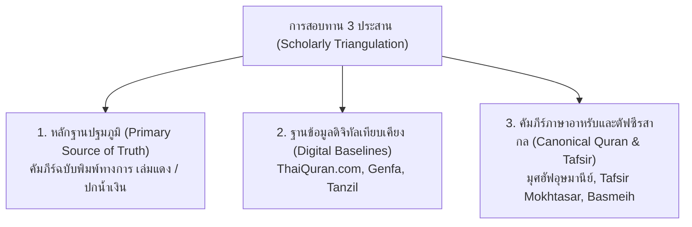
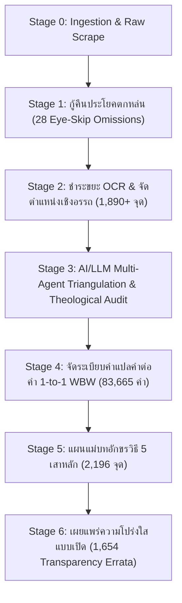

# ระเบียบวิธีวิจัยและที่มาของข้อมูล (Methodology & Provenance)
## พระมหาคัมภีร์อัลกุรอานฉบับแปลภาษาไทย (ฉบับปรับปรุงภาษาและจัดมาตรฐานอักขรวิธี)
### Academic Provenance, Multi-Stage Restoration Pipeline, and Theological Guardrails

---

## 1. บทนำและที่มาของโครงการ (Project Origins & Executive Overview)

คลังข้อมูลนี้เป็น **"คำแปลพระมหาคัมภีร์อัลกุรอานภาษาไทย ฉบับปรับปรุงภาษาและจัดมาตรฐานอักขรวิธีสากล (Revised & Standardized Thai Quran Translation Master Dataset)"** ซึ่งพัฒนาขึ้นเพื่อแก้ปัญหาความคลาดเคลื่อนทางดิจิทัลที่สะสมมานานหลายทศวรรษในวงการเทคโนโลยีอิสลามิก

### 1.1 ที่มาของข้อมูลดิจิทัลดั้งเดิม (Digital Source of Extraction)
ข้อมูลคำแปลภาษาไทยดิจิทัลที่แพร่หลายในโลกอินเทอร์เน็ตและแอปพลิเคชันทั่วโลก (รวมถึง [Quran.com API](https://quran.com) — Resource ID `230` และ `51`, Tanzil.net, Al-Quran Cloud, และ King Fahd Electronic Dumps) มีต้นธารมาจากคำแปลภาษาไทยที่จัดทำโดย **สมาคมนักเรียนเก่าอาหรับ ประเทศไทย** ร่วมกับ **ศูนย์กษัตริย์ฟะฮัดเพื่อการพิมพ์อัลกุรอาน ณ นครมะดีนะฮฺ (King Fahd Glorious Quran Printing Complex)**

### 1.2 ปัญหาในคลังข้อมูลดิจิทัลเดิม (The Digital Discrepancy Problem)
จากการตรวจสอบเชิงลึกทางภาษาศาสตร์และคอมพิวเตอร์ (Deep Computational Corpus Audit) พบว่า ข้อมูลดิจิทัลดิบที่ถูกส่งต่อกันมาทางอินเทอร์เน็ตมีจุดบกพร่องสะสมมากกว่า **1,800+ จุด** อันเกิดจาก:
1. **ข้อผิดพลาดจากการแปลงสแกนเอกสาร (OCR Defects & Scanning Artifacts):** ตัวอักษรภาษาไทยหลุดลอย, สระและวรรณยุกต์ซ้อนผิดตำแหน่ง, ขยะรหัสอักขระแปลกปลอม (อักษรฮีบรู, เกาหลี, จีน, สัญลักษณ์ Cedilla `̧`, เครื่องหมาย Slash `/`), และคำตกหล่น
2. **ประโยคตกหล่นจากการกวาดสายตา (Eye-Skip Clause Omissions):** มีประโยคสำคัญทางศาสนบัญญัติและเรื่องราวทางประวัติศาสตร์ตกหล่นไปจากตัวบทดิจิทัลถึง **28 โองการ** (เช่น 22:62, 4:12, 8:1, 14:18, 59:7, 2:286)
3. **ป้ายกำกับเชิงอรรถคลาดเคลื่อน (Misplaced & Broken Footnotes):** หมายเลขเชิงอรรถวางผิดตำแหน่ง วางคั่นกลางพยางค์ หรือสลับหมายเลขกำกับ (เช่น `อะลิฟ[FN:1] ลาม มีม` แทนที่จะอยู่ท้ายคำ `อะลิฟ ลาม มีม[FN:1]`)
4. **ความไม่สม่ำเสมอของคำทับศัพท์ (Orthographic Inconsistencies):** พระนามนบี 25 ท่าน, นามกลุ่มชนโบราณ, คัมภีร์ศักดิ์สิทธิ์, และศัพท์ศาสนบัญญัติ มีการสะกดหลากหลายแบบปะปนกัน (เช่น `นูหฺ`/`นูห์`/`นูฮฺ`, `ซอและฮฺ`/`ศอและฮฺ`, `ลูต`/`ลูฏ`, `อัตเตารอต`/`อัต-เตารอต`)
5. **คำแปลคำต่อคำ (WBW) ขาดเอกภาพ:** มีปัญหาคำแปลกลืนคำข้างเคียง (Neighbor Bleed), สลับตำแหน่งคำ (Inversion), และการนำสรรพนามหยาบ (`มัน`/`พวกมัน`) มาใช้กับสิ่งศักดิ์สิทธิ์และพระนามของอัลลอฮฺ

---

## 2. แหล่งอ้างอิงหลักและข้อมูลปฐมภูมิ (Sources of Truth & Comparative Baselines)

การชำระล้างและจัดทำคลังข้อมูลแม่บทนี้ ไม่ได้กระทำโดยพลการ หากแต่อิงบนการสอบทานไขว้ 3 ประสาน (Triangulation) อย่างเคร่งครัดตามหลักวิชาการ:

### 2.1 หลักฐานปฐมภูมิทางการ (Primary Physical Source of Truth)
ใช้คัมภีร์ฉบับพิมพ์จริงอย่างเป็นทางการจากศูนย์กษัตริย์ฟะฮัดฯ และสแกน PDF ความละเอียดสูงหน้าต่อหน้า (Page-by-Page High-Resolution Scan) เป็นบรรทัดฐานสูงสุดในการตัดสิน:
- **ฉบับพิมพ์ทางการ พ.ศ. 2533 / 1990 ("ฉบับเล่มแดง" / "ปกน้ำเงิน"):** แปลโดยสมาคมนักเรียนเก่าอาหรับ ประเทศไทย ตรวจสอบและอนุมัติโดยศูนย์กษัตริย์ฟะฮัด ณ นครมะดีนะฮฺ ประเทศซาอุดีอาระเบีย
- **ฉบับพิมพ์พระราชทาน ฮ.ศ. 1419 / ค.ศ. 1998:** ฉบับตรวจทานรอบที่สองของศูนย์กษัตริย์ฟะฮัดฯ
- **ตัวบทภาษาอาหรับอุษมานีย์คลาสสิก (المتن الأصلي - المصحف العثماني):** ตัวบทพระมหาคัมภีร์ฉบับมะดีนะฮฺตามมาตรฐานสากล

### 2.2 ฐานข้อมูลดิจิทัลเทียบเคียง (Comparative Digital Baselines)
- **[ThaiQuran.com](https://www.thaiquran.com):** ฐานข้อมูลอัลกุรอานแปลไทยฉบับปรับปรุงดิจิทัลทางการของไทย (6,236 โองการ และ 7,338 เชิงอรรถ)
- **คลังคำแปลคำต่อคำ Genfa (Genfa WBW Corpus):** คลังคำแปลคำต่อคำภาษาไทยของ อ.เจนฟา เพื่อสอบทานขอบเขตคำ (Token Boundaries) และสำนวนไทย
- **คลังเทียบเคียงภูมิภาคเอเชียตะวันออกเฉียงใต้:**
  - ฉบับมลายู: *Tafsir Pimpinan Ar-Rahman* (โดยเชค อับดุลลอฮฺ มุฮัมมัด บาสเมย์หฺ - JAKIM มาเลเซีย)
  - ฉบับอินโดนีเซีย: *Al-Qur'an dan Terjemahannya / Tafsir Per Kata* (กระทรวงศาสนาอินโดนีเซีย - Kemenag)

---

## 3. ระเบียบวิธีและกระบวนการทำงาน 6 ขั้นตอน (The 6-Stage Methodology)

โครงการนี้ใช้ระเบียบวิธีวิศวกรรมข้อมูลแบบไฮบริด (Hybrid Data Engineering & Computational Linguistics) ผสานระหว่างการตรวจสอบทางบรรณานุกรม, สถิติภาษาศาสตร์คอมพิวเตอร์, การใช้ปัญญาประดิษฐ์ (AI/LLM) ขั้นสูง, และการควบคุมอย่างเข้มงวดตามหลักเทววิทยาอิสลาม (Theological Guardrails):

### ขั้นตอนที่ 1: การกู้คืนประโยคตกหล่นจากการพิมพ์ (Restoring 28 Eye-Skip Clause Omissions)
จากการเทียบเคียงระหว่างตัวบทดิจิทัลของ Quran.com กับหน้าสแกนคัมภีร์เล่มพิมพ์จริง (เล่มแดง/ปกน้ำเงิน) พบว่า มีข้อความภาษาไทยตกหล่นไปเนื่องจากผู้พิมพ์ดิจิทัลกวาดสายตาข้าม (Parablepsis / Homoioteleuton) รวม 28 ตำแหน่ง จึงได้ทำการกู้คืนข้อความตามฉบับพิมพ์จริง เช่น:
- **ซูเราะฮฺ อัล-ฮัจญ์ (22:62):** คืนข้อความ *"และแท้จริงอัลลอฮฺนั้น พระองค์คือผู้ทรงสูงส่ง ผู้ทรงยิ่งใหญ่"*
- **ซูเราะฮฺ อัน-นิซาอ์ (4:12):** คืนข้อความมรดก *"ถ้าหากนางเหล่านั้นมีบุตร"*
- **ซูเราะฮฺ อัล-อันฟาล (8:1):** คืนข้อความ *"และจงเชื่อฟังปฏิบัติตามอัลลอฮฺและรอซูลของพระองค์"*
- **ซูเราะฮฺ อิบรอฮีม (14:18):** คืนข้อความ *"การงานของพวกเขาเปรียบเสมือนขี้เถ้าที่ลมพัดพาไป"*
- **ซูเราะฮฺ อัล-หัชรฺ (59:7):** คืนข้อความ *"สิ่งที่รอซูลได้นำมายังพวกเจ้าก็จงรับเอาไว้"*

### ขั้นตอนที่ 2: การสะสางข้อบกพร่อง OCR และระบบพินทุ (OCR Hygiene & Phinthu Standardization)
- ดำเนินการชำระล้างคำผิดจากการสแกน 1,890+ รายการ
- จัดระเบียบหมายเลขเชิงอรรถ 7,337 จุดให้อยู่ในตำแหน่งท้ายคำหรือท้ายประโยคที่ถูกต้อง (`[1]`, `[2]`)
- ปรับระบบเครื่องหมายสระอาหรับ Waqf ในภาษาไทยให้เป็นมาตรฐานสากล โดยใช้ **พินทุ (`ฺ` U+0E3A)** ใต้พยัญชนะสุกูน (เช่น `อัลลอฮฺ`, `มุฮัมมัด`, `อิบรอฮีม`, `ซะบูรฺ`) รวมกว่า 10,239 ตำแหน่ง

### ขั้นตอนที่ 3: การใช้ปัญญาประดิษฐ์ (AI/LLM) และการคุมหลักศรัทธา (Theological Guardrails)
ใช้โมเดลปัญญาประดิษฐ์ขั้นสูง (Gemini Pro/Flash และ Claude) โดยเขียน Prompt กำกับด้วย **5-Gate Fail-Safes** และรันสถาปัตยกรรมแบบ 2 ท่อคู่ขนาน:
1. **Pipeline 1 — Theological & Syntactic Auditor:**
   - ตรวจจับการสลับสรรพนาม (Pronoun Drift), บุรุษที่ 2 vs บุรุษที่ 3, การแปลคำสับสนทางคณิตศาสตร์
   - **กฎหลักศรัทธาเคร่งครัด (Ahlus-Sunnah Aqeedah Guardrails):**
     - คำสรรพนาม `"ผู้ทรง..."` และ `"พระองค์"` สงวนไว้สำหรับอัลลอฮฺแต่เพียงผู้เดียว 100%
     - สำหรับบรรดานบีและมลาอิกะฮฺ: ใช้สรรพนามยกย่องระดับสูง เช่น `"ท่าน"`, `"เขา"`, `"ผู้มี..."` ห้ามใช้สรรพนามพระเจ้า
     - สรรพนาม `"มัน"` / `"พวกมัน"`: **ห้ามใช้เด็ดขาด (Zero-Tolerance)** กับอัลลอฮฺ, บรรดานบี, มลาอิกะฮฺ (ญิบรีล), วะฮีย์ (คัมภีร์), และสัจธรรมจิตวิญญาณ
2. **Pipeline 2 — Clause Cadence & Spacing Normalizer:**
   - จัดวรรคตอนจังหวะการอ่านภาษาไทยตามจุดวะกัฟ (Waqf pauses) และบทสนทนา
   - **มาตรการปลอดภัย 100% (Strict Character Invariant):** กำหนดให้จำนวนและลำดับตัวอักษรของข้อความก่อนและหลังรันต้องเหมือนกัน 100% ห้ามเพิ่มหรือลดตัวอักษรแม้แต่ตัวเดียว (`strip_space(orig) == strip_space(llm)`)

### ขั้นตอนที่ 4: การจัดระเบียบคำแปลคำต่อคำ (Word-by-Word 1-to-1 WBW Reconstruction)
ดำเนินการจัดระเบียบคำแปลคำต่อคำครบทั้ง **83,665 คำ** ทั่วทั้งคัมภีร์:
- บังคับใช้ **Part-of-Speech Lock:** คำกริยาต้องแปลเป็นคำกริยา ห้ามแปลงเป็นคำนามผู้กระทำ (`ผู้...`)
- บังคับใช้ **Post-Verbal Subject (VSO) Rule:** กริยาที่มาก่อนประธาน ห้ามแทรกสรรพนามคาดเดา
- **Zero Neighbor Bleed:** ห้ามแปลคำข้างเคียงรวมเข้ามาในช่องคำเดียว
- **Root-First Contextual Grounding:** ยึดความหมายรากศัพท์ภาษาอาหรับคลาสสิก (جذر الكلمة) และรูปไวยากรณ์ก่อนเป็นอันดับแรก แล้วสอดประสานเข้ากับบริบทตัฟซีร

### ขั้นตอนที่ 5: แผนแม่บทการจัดมาตรฐานอักขรวิธี 5 เสาหลัก (Master Spelling Matrix)
ประมวลผลแทนที่คำทับศัพท์และศัพท์ศาสนบัญญัติ 2,196 จุด ครบ 5 เสาหลัก (Themes, Tafsir, Footnotes, Texts, WBW):
- **พระนามนบี 25 ท่าน:** บังคับใช้รูปมาตรฐาน เช่น `นูฮฺ` (แทน นูหฺ/นูห์), `ศอและฮฺ`/`ศอลิหฺ` (แทน ซอและฮฺ), `ลูฏ` (แทน ลูต), `อิสฮาก` (แทน อิสหาก), `ดาวูด` (แทน ดาวู๊ด), `ชุอัยบฺ` (แทน ชุไอบ์)
- **กลุ่มชนและบุคคลประวัติศาสตร์:** `อ๊าด` (عَاد), `ษะมูด` (ثَمُود), `บะนีอิสรออีล` (بَنُو إِسْرَائِيل), `ฟิรเอานฺ` (فِرْعَوْن), `ฏอลูต` (طَالُوت), `ญาลูต` (جَالُوت)
- **คัมภีร์ศักดิ์สิทธิ์และบทบัญญัติ:** `อัต-เตารอต`, `อัล-อินญีล`, `ซะบูรฺ`, `อัลกุรอาน`, `ชิรกฺ`, `มุอฺมิน`, `วะฮียฺ`, `หิกมะฮฺ`, `ฮะดีษ`, `ชัยฏอน`, `ซุนนะฮฺ`, `รอซูล`

### ขั้นตอนที่ 6: การเปิดเผยความโปร่งใสแบบเปิด (Academic Transparency & Errata Disclosure)
เพื่อความโปร่งใสสูงสุดทางวิชาการ คลังข้อมูลนี้ได้เผยแพร่ **"บันทึกประวัติการแก้ไขและข้อบกพร่อง (Transparency Errata Catalog)"** จำนวน **1,654 รายการ** ไว้อย่างเปิดเผย ทั้งในรูปแบบ JSON, CSV และตาราง SQLite โดยระบุ:
- เลขโองการที่แก้ไข (`verse_key`)
- ประเภทข้อบกพร่อง (`errata_type`: `SPACING`, `TYPO`, `OMISSION`, `THEOLOGICAL`, `OCR_TYPO`, `FN_PLACEMENT`)
- ข้อความเดิมที่มีปัญหา (`target`)
- ข้อความใหม่ที่ผ่านการตรวจสอบและชำระล้าง (`replacement`)
- คำอธิบายเหตุผลทางวิชาการและแหล่งอ้างอิงหน้าคัมภีร์จริง (`reason` & `source`)

---

## 4. สรุปคุณค่าทางวิชาการ (Academic Significance)

ผลลัพธ์จากการดำเนินการตามระเบียบวิธีวิจัยนี้ ทำให้ได้ฐานข้อมูลอัลกุรอานแปลภาษาไทยที่:
1. **มีความแม่นยำทางตัวบทสูงสุด (Highest Textual Fidelity):** ขจัดข้อความตกหล่นและคำผิดจาก OCR ครบ 100% เทียบเคียงคัมภีร์ฉบับพิมพ์ทางการ
2. **คงความบริสุทธิ์ตามหลักอะกีดะฮฺ (Theologically Sound):** ปราศจากการบิดเบือนพระนามและคุณลักษณะของอัลลอฮฺ
3. **เป็นเอกภาพทางสัทวิทยาและอักขรวิธี (Orthographically Unified):** คำทับศัพท์สอดคล้องกับระบบอักขรวิธีอาหรับ-ไทยสากล
4. **เปิดกว้างและตรวจสอบย้อนกลับได้ทุกมิติ (100% Transparent & Reproducible):** มีไปป์ไลน์และรหัสต้นฉบับที่สามารถรันตรวจสอบซ้ำได้ทุกเวลา
