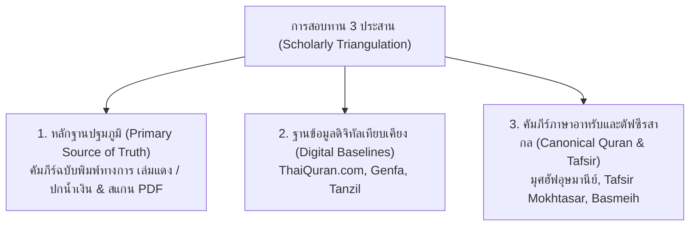

# Thai Quran Translation Master Dataset
### คำแปลพระมหาคัมภีร์อัลกุรอานภาษาไทย ฉบับปรับปรุงภาษาและจัดมาตรฐานอักขรวิธีสากล
**The Canonical Master Dataset for Thai Quran Translation (JSON, CSV & SQLite)**

[](https://creativecommons.org/licenses/by-sa/4.0/)
[](https://www.sqlite.org/)
[](#)
[](#)
[](#)
[](#)
[](METHODOLOGY.md)

---

## 1. บทนำและที่มาของโครงการ (Academic Introduction & Provenance)

คลังข้อมูลชุดนี้เป็น **"คำแปลพระมหาคัมภีร์อัลกุรอานภาษาไทย ฉบับปรับปรุงภาษาและจัดมาตรฐานอักขรวิธีสากล (Revised & Standardized Thai Quran Translation Master Dataset)"** ซึ่งสังเคราะห์และชำระล้างขึ้นเพื่อแก้ปัญหาความคลาดเคลื่อนทางดิจิทัลที่สะสมมานานในวงการเทคโนโลยีอิสลามิก ให้เป็นฐานข้อมูลแม่บทที่มีความถูกต้องทางวิชาการ ความสมบูรณ์ทางไวยากรณ์ และความบริสุทธิ์ตามหลักศรัทธาของอิสลาม (Ahlus-Sunnah wal-Jama'ah)

### 1.1 แหล่งที่มาของข้อมูลดิจิทัลดั้งเดิม (Original Digital Sources)
ข้อมูลคำแปลภาษาไทยดิจิทัลที่แพร่หลายในโลกอินเทอร์เน็ตและแอปพลิเคชันทั่วโลก (รวมถึง [Quran.com API](https://quran.com) — Resource ID `230` และ `51`, Tanzil.net, Al-Quran Cloud, และ King Fahd Electronic Dumps) มีต้นธารมาจากคำแปลภาษาไทยที่จัดทำโดย **สมาคมนักเรียนเก่าอาหรับ ประเทศไทย** ร่วมกับ **ศูนย์กษัตริย์ฟะฮัดเพื่อการพิมพ์อัลกุรอาน ณ นครมะดีนะฮฺ (King Fahd Glorious Quran Printing Complex)**

### 1.2 เหตุผลและความจำเป็นในการปรับปรุง (Why We Fixed It)
จากการตรวจสอบเชิงลึกทางภาษาศาสตร์และคอมพิวเตอร์ (Deep Computational Corpus Audit) พบว่า ข้อมูลดิจิทัลดิบที่ถูกส่งต่อกันมาทางอินเทอร์เน็ตมีจุดบกพร่องสะสมมากกว่า **1,800+ จุด** อันเกิดจาก:
1. **ข้อผิดพลาดจากการสแกนและแปลงข้อความ (OCR Defects & Scanning Artifacts):** ตัวอักษรหลุดลอย, สระและวรรณยุกต์ซ้อนผิดตำแหน่ง, ขยะรหัสอักขระแปลกปลอม (อักษรฮีบรู, เกาหลี, จีน, สัญลักษณ์ Cedilla `̧`, เครื่องหมาย Slash `/`)
2. **ประโยคตกหล่นจากการกวาดสายตา (Eye-Skip Clause Omissions):** มีประโยคสำคัญทางศาสนบัญญัติและเรื่องราวทางประวัติศาสตร์ตกหล่นไปจากตัวบทดิจิทัลถึง **28 โองการ** (เช่น 22:62, 4:12, 8:1, 14:18, 59:7, 2:286)
3. **ป้ายกำกับเชิงอรรถคลาดเคลื่อน (Misplaced & Broken Footnotes):** หมายเลขเชิงอรรถวางผิดตำแหน่ง วางคั่นกลางพยางค์ หรือสลับหมายเลขกำกับ (เช่น `อะลิฟ[FN:1] ลาม มีม` แทนที่จะอยู่ท้ายคำ `อะลิฟ ลาม มีม[FN:1]`)
4. **ความไม่สม่ำเสมอของคำทับศัพท์ (Orthographic Inconsistencies):** พระนามนบี 25 ท่าน, นามกลุ่มชนโบราณ, คัมภีร์ศักดิ์สิทธิ์, และศัพท์ศาสนบัญญัติ มีการสะกดหลากหลายแบบปะปนกัน
5. **คำแปลคำต่อคำ (WBW) ขาดเอกภาพ:** ปัญหาคำแปลกลืนคำข้างเคียง (Neighbor Bleed), สลับตำแหน่งคำ (Inversion), และการนำสรรพนามหยาบ (`มัน`/`พวกมัน`) มาใช้กับสิ่งศักดิ์สิทธิ์

---

## 2. แหล่งอ้างอิงหลักและข้อมูลปฐมภูมิ (Sources of Truth & Verification Baselines)

การชำระล้างและจัดทำคลังข้อมูลแม่บทนี้ อิงบนการสอบทานไขว้ 3 ประสาน (Triangulation) อย่างเคร่งครัดตามหลักวิชาการ:



1. **หลักฐานปฐมภูมิทางการ (Primary Physical Source of Truth):**
   - **ฉบับเล่มแดง (พ.ศ. 2533 / 1990):** คำแปลทางการโดยสมาคมนักเรียนเก่าอาหรับ ประเทศไทย ตรวจสอบและอนุมัติโดยศูนย์กษัตริย์ฟะฮัด ณ นครมะดีนะฮฺ ประเทศซาอุดีอาระเบีย
   - **ฉบับปกน้ำเงิน (ฮ.ศ. 1419 / ค.ศ. 1998):** ฉบับตรวจทานรอบที่สองของศูนย์กษัตริย์ฟะฮัดฯ
   - **ไฟล์สแกน PDF ความละเอียดสูงหน้าต่อหน้า (Page-by-Page High-Res Scans):** สแกนจากตัวเล่มจริงเพื่อตรวจพิสูจน์อักษร
   - **ตัวบทภาษาอาหรับอุษมานีย์คลาสสิก (المتن الأصلي - المصحف العثماني):** บรรทัดฐานสูงสุดในการถอดความ
2. **ฐานข้อมูลดิจิทัลเทียบเคียง (Comparative Digital Baselines):**
   - **[ThaiQuran.com](https://www.thaiquran.com):** ฐานข้อมูลอัลกุรอานแปลไทยฉบับปรับปรุงดิจิทัลทางการของไทย (6,236 โองการ และ 7,338 เชิงอรรถ)
   - **คลังคำแปลคำต่อคำ Genfa (Genfa WBW Corpus):** คลังคำแปลคำต่อคำภาษาไทยของ อ.เจนฟา เพื่อสอบทานขอบเขตคำและสำนวนไทย
   - **คลังเทียบเคียงภูมิภาคเอเชียตะวันออกเฉียงใต้:** ฉบับมลายู *Tafsir Pimpinan Ar-Rahman* (Basmeih / JAKIM) และฉบับอินโดนีเซีย *Tafsir Per Kata* (Kemenag)

---

## 3. ระเบียบวิธีวิจัยและไปป์ไลน์การแก้ไข 6 ขั้นตอน (The 6-Stage Restoration Pipeline)

*(อ่านเอกสารฉบับเต็มอย่างละเอียดได้ที่ [`METHODOLOGY.md`](METHODOLOGY.md))*

1. **กู้คืน 28 ประโยคตกหล่น (Restoring 28 Eye-Skip Clause Omissions):**
   - ตรวจสอบเทียบตัวเล่มจริงและสแกน PDF เพื่อกู้คืนประโยคที่ผู้พิมพ์ดิจิทัลกวาดสายตาข้ามไป เช่น 22:62, 4:12, 8:1, 14:18, 59:7, 2:286
2. **ชำระล้างขยะ OCR และจัดระบบพินทุ (OCR Hygiene & Phinthu Standardization):**
   - แก้ไขคำผิดจากการสแกน 1,890+ รายการ
   - จัดระเบียบหมายเลขเชิงอรรถ 7,337 จุดให้อยู่ในตำแหน่งท้ายคำที่ถูกต้อง (`[1]`, `[2]`)
   - ใช้ **พินทุ (`ฺ` U+0E3A)** ใต้พยัญชนะสุกูนตามมาตรฐานเสียงสากล (เช่น `อัลลอฮฺ`, `มุฮัมมัด`, `อิบรอฮีม`, `ซะบูรฺ`) รวม 10,239 ตำแหน่ง
3. **การประยุกต์ใช้ AI/LLM ภายใต้การควบคุมทางเทววิทยา (Theological Guardrails):**
   - รันโมเดลปัญญาประดิษฐ์ชั้นสูง (Gemini Pro/Flash และ Claude) ผ่านระบบตรวจสอบ 2 ท่อคู่ขนาน:
     - **Pipeline 1 (Theological & Typo Auditor):** ตรวจจับการสลับสรรพนาม, ความคลาดเคลื่อนทางคณิตศาสตร์, คุมสรรพนาม `"ผู้ทรง..."` และ `"พระองค์"` สำหรับอัลลอฮฺ 100%, และบังคับใช้เกณฑ์ Zero-Tolerance ต่อสรรพนามหยาบ (`มัน`/`พวกมัน`) สำหรับสิ่งศักดิ์สิทธิ์
     - **Pipeline 2 (Clause Cadence & Spacing Normalizer):** จัดวรรคตอนภาษาไทยตามจุดวะกัฟ (Waqf) ภายใต้กฎ **100% Strict Character Invariant** (`strip_space(orig) == strip_space(llm)`)
4. **จัดระเบียบคำแปลคำต่อคำ (Word-by-Word 1-to-1 WBW Reconstruction — 83,665 คำ):**
   - บังคับใช้ **Part-of-Speech Lock** (กริยาต้องแปลเป็นกริยา ห้ามแปลงเป็นนามผู้กระทำ), **Post-Verbal Subject (VSO) Rule**, และยึดความหมายตามรากศัพท์อาหรับคลาสสิก (جذر الكلمة)
5. **แผนแม่บทการจัดมาตรฐานอักขรวิธี 5 เสาหลัก (Master Spelling Matrix — 2,196 จุด):**
   - ปรับปรุงพระนามนบี 25 ท่าน (นูฮฺ, ศอลิหฺ, ลูฏ, อิสฮาก, ดาวูด, ชุอัยบฺ), นามกลุ่มชนโบราณ (อ๊าด, ษะมูด, บะนีอิสรออีล, ฟิรเอานฺ), คัมภีร์ (อัต-เตารอต, อัล-อินญีล, ซะบูรฺ, อัลกุรอาน), และศัพท์บัญญัติ (ชิรกฺ, มุอฺมิน, วะฮียฺ, หิกมะฮฺ, ฮะดีษ, ชัยฏอน, รอซูล)
6. **การเปิดเผยความโปร่งใสแบบเปิด (Academic Transparency & Errata Disclosure — 1,654 รายการ):**
   - เผยแพร่ประวัติการแก้ไขและข้อบกพร่องทุกจุดไว้อย่างเปิดเผยในรูปแบบ JSON, CSV และ SQLite พร้อมเหตุผลและแหล่งอ้างอิง

---

## 4. โครงสร้างชุดข้อมูลและผังไดเรกทอรี (Directory Layout)

```
thai-quran-master-data/
├── README.md                               # คู่มือการใช้งานและบทนำทางวิชาการ
├── METHODOLOGY.md                          # รายละเอียดระเบียบวิธีวิจัยและที่มาของข้อมูลฉบับเต็ม
├── SCHEMA.md                               # รายละเอียดสคีมาของ SQLite, JSON และ CSV
├── json/                                   # ชุดข้อมูล JSON มาตรฐาน (UTF-8, 2-space indent)
│   ├── surahs.json                         # ข้อมูลซูเราะฮฺทั้ง 114 บท (0.02 MB)
│   ├── quran_thai_translation.json         # ตัวบทอาหรับและคำแปล 6,236 โองการ (13.96 MB)
│   ├── quran_footnotes.json                # เชิงอรรถอธิบาย 7,337 ข้อ (4.15 MB)
│   ├── quran_wbw_th_en.json                # คำแปลคำต่อคำ 83,665 คำ (31.58 MB)
│   ├── quran_tafsir_mokhtasar.json         # ตัฟซีรย่อภาษาไทย 6,236 โองการ (5.70 MB)
│   ├── quran_themes.json                   # ธีมเนื้อหา 1,085 ช่วง (0.87 MB)
│   ├── quran_topics.json                   # หมวดหมู่และดัชนี 30 หัวข้อ (0.03 MB)
│   └── quran_transparency_catalog.json     # บันทึกความโปร่งใส 1,654 รายการ (1.24 MB)
├── csv/                                    # ชุดข้อมูลตาราง CSV (Excel UTF-8 with BOM)
│   ├── quran_transparency_catalog.csv      # บันทึกความโปร่งใส 1,654 แถว (0.91 MB)
│   ├── surahs.csv                          # ดัชนีซูเราะฮฺ 114 แถว (7.7 KB)
│   └── quran_thai_translation.csv          # ตัวบทและคำแปล 6,236 แถว (7.38 MB)
├── sqlite/                                 # ฐานข้อมูล SQLite มาตรฐาน
│   └── thai_quran_master.db                # ไฟล์ SQLite รวมทุกตาราง (40.8 MB)
└── scripts/                                # สคริปต์ไปป์ไลน์
    ├── build_master_datasets.py            # สคริปต์สังเคราะห์ข้อมูลต้นทาง
    └── verify_master_datasets.py           # สคริปต์ตรวจความถูกต้อง 100%
```

---

## 5. ตัวอย่างการดึงข้อมูล (Usage & Examples)

### 5.1 การคิวรีด้วย SQLite (Python)

```python
import sqlite3

conn = sqlite3.connect("sqlite/thai_quran_master.db")
c = conn.cursor()

# 1. ค้นหาคำแปลและเชิงอรรถของโองการ 1:4
query = """
    SELECT v.verse_key, v.arabic_uthmani, v.translation_annotated_th, f.text AS footnote
    FROM verses v
    LEFT JOIN footnotes f ON v.verse_key = f.verse_key
    WHERE v.verse_key = '1:4'
"""
c.execute(query)
row = c.fetchone()
print(f"[{row[0]}] {row[1]}")
print(f"คำแปล: {row[2]}")
print(f"เชิงอรรถ: {row[3]}")

# 2. ดึงประวัติการแก้ไขในรายงานความโปร่งใส (Transparency Errata) ของซูเราะฮฺที่ 2
c.execute("""
    SELECT verse_key, errata_type, target, replacement, reason
    FROM transparency_catalog
    WHERE surah_id = 2 AND errata_type = 'THEOLOGICAL'
""")
for r in c.fetchall():
    print(f"[{r[0]}] {r[1]}: '{r[2]}' ➔ '{r[3]}' | เหตุผล: {r[4]}")

conn.close()
```

### 5.2 การอ่านข้อมูล JSON (Node.js / TypeScript)

```typescript
import * as fs from 'fs';

// อ่านรายงานความโปร่งใสสำหรับหน้า /transparency
const errata = JSON.parse(fs.readFileSync('json/quran_transparency_catalog.json', 'utf-8'));
console.log(`โหลดข้อมูล Errata ทั้งหมด: ${errata.length} รายการ`);

const sample = errata.find((e: any) => e.verse_key === '2:1');
console.log(`[${sample.verse_key}] ${sample.type}: ${sample.target} -> ${sample.replacement}`);
```

### 5.3 การเปิดไฟล์ CSV ด้วย Pandas

```python
import pandas as pd

# อ่านไฟล์ความโปร่งใส (เปิดได้ทันทีใน Excel และ Pandas)
df = pd.read_csv("csv/quran_transparency_catalog.csv")
print("สรุปประเภทการแก้ไข (Errata Types):")
print(df["type"].value_counts())
```

---

## 6. การตรวจสอบความสมบูรณ์ของข้อมูล (Integrity Verification)

ท่านสามารถรันชุดทดสอบเพื่อตรวจสอบความสมบูรณ์ของโครงสร้างข้อมูล ดัชนี และจำนวนแถวทุกตารางได้ตลอดเวลา:

```bash
python scripts/verify_master_datasets.py
```

ผลลัพธ์การตรวจสอบมาตรฐาน:
- **Database Integrity:** `PRAGMA integrity_check = ok`
- **Total Surahs:** 114 บท
- **Total Verses:** 6,236 โองการ
- **Total Words:** 83,665 คำ (WBW)
- **Total Footnotes:** 7,337 รายการ
- **Total Tafsir:** 6,236 โองการ
- **Total Themes:** 1,085 ช่วง
- **Total Transparency Records:** 1,654 รายการ

---

## 7. ลิขสิทธิ์และการอ้างอิง (License & Attribution)

- **ตัวบทพระมหาคัมภีร์อัลกุรอานภาษาอาหรับ:** ศูนย์กษัตริย์ฟะฮัดเพื่อการพิมพ์อัลกุรอาน (King Fahd Glorious Quran Printing Complex, Madinah)
- **คำแปลพระมหาคัมภีร์ภาษาไทยและเชิงอรรถ:** สมาคมนักเรียนเก่าอาหรับ ประเทศไทย / ศูนย์กษัตริย์ฟะฮัดฯ
- **ชุดข้อมูลและการจัดระเบียบโครงสร้าง:** เผยแพร่ภายใต้สัญญาอนุญาต [Creative Commons Attribution-ShareAlike 4.0 International (CC BY-SA 4.0)](https://creativecommons.org/licenses/by-sa/4.0/)
