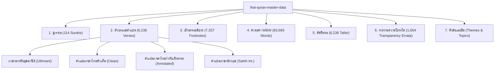

# Thai Quran Translation Master Dataset
### ฐานข้อมูลพระมหาคัมภีร์อัลกุรอานฉบับแปลภาษาไทย มาตรฐานสากลครบวงจร (JSON, CSV & SQLite)

[](https://creativecommons.org/licenses/by-sa/4.0/)
[](https://www.sqlite.org/)
[](#)
[](#)
[](#)
[](#)

---

## 1. บทนำ (Introduction)

คลังข้อมูลชุดนี้เป็น **"ฐานข้อมูลแม่บทฉบับสมบูรณ์ (Canonical Master Dataset)"** สำหรับการศึกษา ค้นคว้า และพัฒนาแอปพลิเคชันอัลกุรอานภาษาไทย โดยรวบรวมเนื้อหาครบทั้ง 5 เสาหลัก พร้อม **"รายงานความโปร่งใสทางวิชาการ (Academic Transparency & Errata Catalog)"** จำนวน 1,654 รายการ ผ่านการจัดมาตรฐานอักขรวิธีคำทับศัพท์และศัพท์ศาสนบัญญัติ 100% ตรงตามหลักภาษาศาสตร์และจารีตอิสลาม

จัดเก็บใน 3 รูปแบบมาตรฐานสากล:
- **`sqlite/thai_quran_master.db`**: ฐานข้อมูลเชิงสัมพันธ์ (Relational Database) ไฟล์เดียวที่เชื่อมโยงตารางอย่างสมบูรณ์ พร้อมดัชนี (Indexes) ความเร็วสูง (40.8 MB)
- **`json/*.json`**: ชุดข้อมูล JSON มาตรฐาน แยกตามประเภท สะดวกต่อการนำไปใช้งานใน Web, Mobile, API, หรือ Data Science Pipeline
- **`csv/*.csv`**: ชุดข้อมูลตาราง CSV (เข้ารหัส UTF-8 with BOM) สำหรับเปิดใช้งานได้ทันทีใน Microsoft Excel, Google Sheets, Pandas และ R

---

## 2. โครงสร้างข้อมูล 5 เสาหลัก และความโปร่งใส (The Architecture)



1. **พระมหาคัมภีร์ (6,236 โองการ):**
   - อาหรับมุศฮัฟมะดีนะฮฺ (Uthmani Script)
   - คำแปลภาษาไทยฉบับมาตรฐานสมาคมนักเรียนเก่าอาหรับฯ (King Fahd Edition v4 Standard)
   - ฉบับกำกับหมายเลขเชิงอรรถ (`[1]`, `[2]`) และฉบับคลีน
   - หมายเลขหน้ามุศฮัฟ (604 หน้า), ญุซอ์ (30 ญุซอ์), และฮิซบ์ (240 ฮิซบ์)
2. **คำแปลคำต่อคำ (Word-by-Word WBW — 83,665 คำ):**
   - แยกคำ 1-to-1 สอดคล้องกับรากศัพท์ภาษาอาหรับคลาสสิก (Classical Arabic Root)
   - คำทับศัพท์สัทอักษร (Phonetic Transliteration)
   - คำแปลภาษาไทยและภาษาอังกฤษประจำตำแหน่งคำ
   - รากศัพท์ภาษาอาหรับ (جذر الكلمة), ประเภทคำ (POS), และ Lemma
3. **เชิงอรรถวิชาการ (7,337 รายการ):**
   - คำอธิบายบริบทการประทานโองการ ประวัติศาสตร์ และขยายความหมายอย่างละเอียด
4. **ตัฟซีรมุคตะศ็อรภาษาไทย (Tafsir Al-Mukhtasar — 6,236 โองการ):**
   - คำอธิบายความหมายสรุปย่อรายโองการจากศูนย์ตัฟซีร ณ นครมักกะฮฺ
5. **รายงานความโปร่งใสทางวิชาการ (Academic Transparency & Errata — 1,654 รายการ):**
   - บันทึกประวัติการตรวจสอบและแก้ไขข้อผิดพลาด/คำตกหล่นจากฉบับพิมพ์ปี 1990 พร้อมเหตุผลและแหล่งอ้างอิงทางวิชาการทุกจุด รองรับการแสดงผลหน้า `/transparency` ในแอปพลิเคชัน
6. **หัวข้อและธีมเนื้อหา (Themes & Topics):**
   - สรุปใจความสำคัญของกลุ่มโองการ 1,085 ช่วง (Ayah Themes)
   - ดัชนีจำแนกตามประเด็นเนื้อหา 30 หัวข้อ ครอบคลุม 1,339 โองการ

---

## 3. ผังโครงสร้างไดเรกทอรี (Directory Layout)

```
thai-quran-master-data/
├── README.md                               # คู่มือการใช้งานและภาพรวม
├── SCHEMA.md                               # รายละเอียดสคีมาของ SQLite, JSON และ CSV
├── json/                                   # ชุดข้อมูล JSON มาตรฐาน
│   ├── surahs.json                         # ข้อมูลซูเราะฮฺทั้ง 114 บท (0.02 MB)
│   ├── quran_thai_translation.json         # ตัวบทอาหรับและคำแปล 6,236 โองการ (13.96 MB)
│   ├── quran_footnotes.json                # เชิงอรรถอธิบาย 7,337 ข้อ (4.15 MB)
│   ├── quran_wbw_th_en.json                # คำแปลคำต่อคำ 83,665 คำ (31.58 MB)
│   ├── quran_tafsir_mokhtasar.json         # ตัฟซีรย่อภาษาไทย 6,236 โองการ (5.70 MB)
│   ├── quran_themes.json                   # ธีมเนื้อหา 1,085 ช่วง (0.87 MB)
│   ├── quran_topics.json                   # หมวดหมู่และดัชนี 30 หัวข้อ (0.03 MB)
│   └── quran_transparency_catalog.json     # บันทึกความโปร่งใส 1,654 รายการ (1.24 MB)
├── csv/                                    # ชุดข้อมูลตาราง CSV (Excel UTF-8 with BOM)
│   ├── quran_transparency_catalog.csv      # บันทึกความโปร่งใส 1,654 แถว (0.91 MB)
│   ├── surahs.csv                          # ดัชนีซูเราะฮฺ 114 แถว (7.7 KB)
│   └── quran_thai_translation.csv          # ตัวบทและคำแปล 6,236 แถว (7.38 MB)
├── sqlite/                                 # ฐานข้อมูล SQLite มาตรฐาน
│   └── thai_quran_master.db                # ไฟล์ SQLite รวมทุกตาราง (40.8 MB)
└── scripts/                                # สคริปต์ไปป์ไลน์
    ├── build_master_datasets.py            # สคริปต์สังเคราะห์ข้อมูลต้นทาง
    └── verify_master_datasets.py           # สคริปต์ตรวจความถูกต้อง 100%
```

---

## 4. ตัวอย่างการดึงข้อมูล (Usage & Examples)

### 4.1 การคิวรีด้วย SQLite (Python)

```python
import sqlite3

conn = sqlite3.connect("sqlite/thai_quran_master.db")
c = conn.cursor()

# 1. ค้นหาคำแปลและเชิงอรรถของโองการ 1:4
query = """
    SELECT v.verse_key, v.arabic_uthmani, v.translation_annotated_th, f.text AS footnote
    FROM verses v
    LEFT JOIN footnotes f ON v.verse_key = f.verse_key
    WHERE v.verse_key = '1:4'
"""
c.execute(query)
row = c.fetchone()
print(f"[{row[0]}] {row[1]}")
print(f"คำแปล: {row[2]}")
print(f"เชิงอรรถ: {row[3]}")

# 2. ดึงประวัติการแก้ไขในรายงานความโปร่งใส (Transparency Errata) ของซูเราะฮฺที่ 2
c.execute("""
    SELECT verse_key, errata_type, target, replacement, reason
    FROM transparency_catalog
    WHERE surah_id = 2 AND errata_type = 'THEOLOGICAL'
""")
for r in c.fetchall():
    print(f"[{r[0]}] {r[1]}: '{r[2]}' ➔ '{r[3]}' | เหตุผล: {r[4]}")

conn.close()
```

### 4.2 การอ่านข้อมูล JSON (Node.js / TypeScript)

```typescript
import * as fs from 'fs';

// อ่านรายงานความโปร่งใสสำหรับหน้า /transparency
const errata = JSON.parse(fs.readFileSync('json/quran_transparency_catalog.json', 'utf-8'));
console.log(`โหลดข้อมูล Errata ทั้งหมด: ${errata.length} รายการ`);

const sample = errata.find((e: any) => e.verse_key === '2:1');
console.log(`[${sample.verse_key}] ${sample.type}: ${sample.target} -> ${sample.replacement}`);
```

### 4.3 การเปิดไฟล์ CSV ด้วย Pandas

```python
import pandas as pd

# อ่านไฟล์ความโปร่งใส
df = pd.read_csv("csv/quran_transparency_catalog.csv")
print("สรุปประเภทการแก้ไข (Errata Types):")
print(df["type"].value_counts())
```

---

## 5. การตรวจสอบความสมบูรณ์ของข้อมูล (Integrity Verification)

ท่านสามารถรันชุดทดสอบเพื่อตรวจสอบความสมบูรณ์ของโครงสร้างข้อมูล ดัชนี และจำนวนแถวทุกตารางได้ตลอดเวลา:

```bash
python scripts/verify_master_datasets.py
```

ผลลัพธ์การตรวจสอบมาตรฐาน:
- **Database Integrity:** `PRAGMA integrity_check = ok`
- **Total Surahs:** 114 บท
- **Total Verses:** 6,236 โองการ
- **Total Words:** 83,665 คำ (WBW)
- **Total Footnotes:** 7,337 รายการ
- **Total Tafsir:** 6,236 โองการ
- **Total Themes:** 1,085 ช่วง
- **Total Transparency Records:** 1,654 รายการ

---

## 6. ลิขสิทธิ์และการอ้างอิง (License & Attribution)

- **ตัวบทพระมหาคัมภีร์อัลกุรอานภาษาอาหรับ:** ศูนย์กษัตริย์ฟะฮัดเพื่อการพิมพ์อัลกุรอาน (King Fahd Glorious Quran Printing Complex, Madinah)
- **คำแปลพระมหาคัมภีร์ภาษาไทยและเชิงอรรถ:** สมาคมนักเรียนเก่าอาหรับ ประเทศไทย / ศูนย์กษัตริย์ฟะฮัดฯ
- **ชุดข้อมูลและการจัดระเบียบโครงสร้าง:** เผยแพร่ภายใต้สัญญาอนุญาต [Creative Commons Attribution-ShareAlike 4.0 International (CC BY-SA 4.0)](https://creativecommons.org/licenses/by-sa/4.0/)
