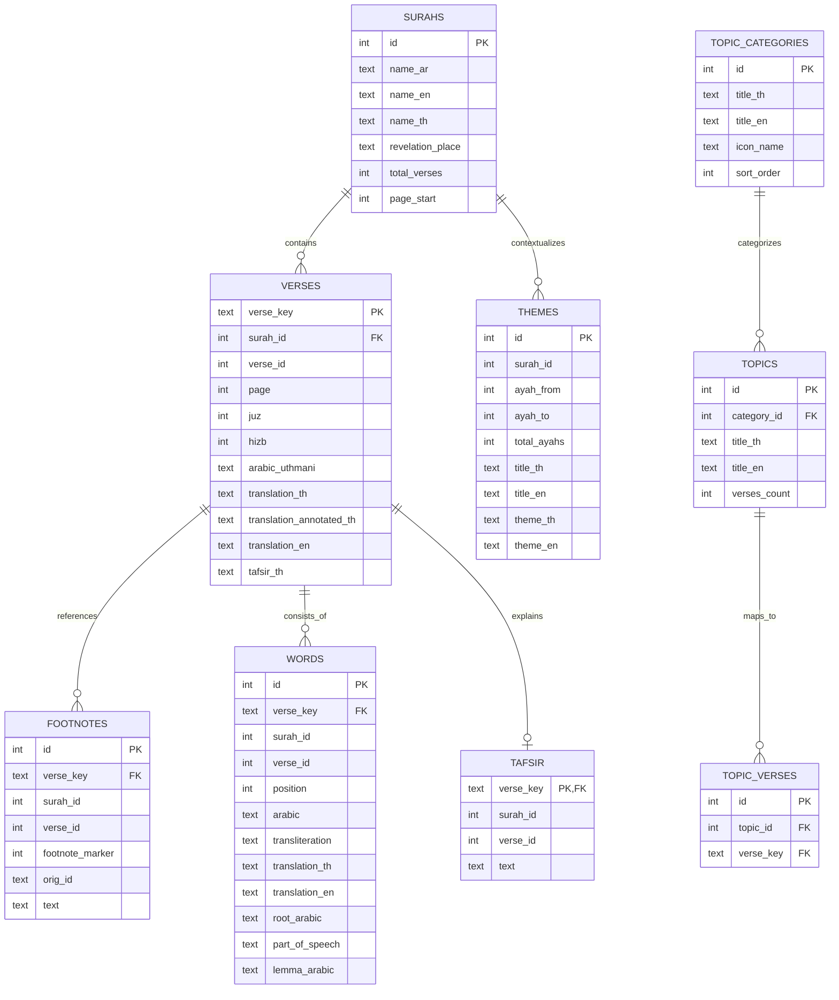

# Data Schema Documentation
## Thai Quran Translation Master Dataset

This document provides the definitive schema specification for both the **SQLite Relational Database** (`sqlite/thai_quran_master.db`) and the **Standard JSON Datasets** (`json/`).

---

## 1. SQLite Relational Schema (`thai_quran_master.db`)

---

## 2. Table Specifications

### 2.1 Table: `metadata`
Stores core repository metadata, versioning, and standardization provenance.
- `key` (TEXT PRIMARY KEY): Configuration/metadata key name.
- `value` (TEXT): Associated value.

### 2.2 Table: `surahs` (114 rows)
Contains standard Quranic Chapter metadata.
- `id` (INTEGER PRIMARY KEY): Surah number (1 - 114).
- `name_ar` (TEXT NOT NULL): Arabic name (e.g. `الفاتحة`).
- `name_en` (TEXT NOT NULL): English transliterated name (e.g. `Al-Fatihah`).
- `name_th` (TEXT NOT NULL): Standard Thai name (e.g. `อัล-ฟาติฮะฮฺ`).
- `revelation_place` (TEXT NOT NULL): `makkah` or `madinah`.
- `total_verses` (INTEGER NOT NULL): Total number of ayahs in the Surah.
- `page_start` (INTEGER NOT NULL): Starting page in the standard 604-page Madinah Mushaf.

### 2.3 Table: `verses` (6,236 rows)
The central verse table containing Arabic Uthmani text, Thai translations (clean and annotated), English translation, and layout indices.
- `verse_key` (TEXT PRIMARY KEY): Canonical key format `surah:verse` (e.g. `1:1`).
- `surah_id` (INTEGER NOT NULL, FK ➔ `surahs.id`): Surah number.
- `verse_id` (INTEGER NOT NULL): Ayah number within the Surah.
- `page` (INTEGER NOT NULL): Page number in the Madinah Mushaf (1 - 604).
- `juz` (INTEGER NOT NULL): Juz number (1 - 30).
- `hizb` (INTEGER NOT NULL): Hizb quarter number (1 - 240).
- `arabic_uthmani` (TEXT NOT NULL): Fully vocalized Uthmani script.
- `translation_th` (TEXT NOT NULL): Standard clean Thai translation (v4 standard without bracket footnotes).
- `translation_annotated_th` (TEXT NOT NULL): Thai translation preserving embedded footnote numbers `[1]`, `[2]`.
- `translation_en` (TEXT NOT NULL): Sahih International English translation.
- `tafsir_th` (TEXT): Verse explanation from Tafsir Al-Mukhtasar in Thai.

### 2.4 Table: `footnotes` (7,337 rows)
The scholarly footnote explanations originally referenced in the King Fahd Thai Quran translation.
- `id` (INTEGER PRIMARY KEY): Unique footnote record ID.
- `verse_key` (TEXT NOT NULL, FK ➔ `verses.verse_key`): Parent verse key.
- `surah_id` (INTEGER NOT NULL): Surah number.
- `verse_id` (INTEGER NOT NULL): Ayah number.
- `footnote_marker` (INTEGER): The index number corresponding to `[1]`, `[2]` in `verses.translation_annotated_th`.
- `orig_id` (TEXT): Historical reference ID in King Fahd edition.
- `text` (TEXT NOT NULL): Full footnote text in standard Thai.

### 2.5 Table: `words` (83,665 rows)
Strict 1-to-1 Word-by-Word (WBW) tokens across the entire Quran.
- `id` (INTEGER PRIMARY KEY): Unique word index (1 to 83,665).
- `verse_key` (TEXT NOT NULL, FK ➔ `verses.verse_key`): Parent verse key.
- `surah_id` (INTEGER NOT NULL): Surah number.
- `verse_id` (INTEGER NOT NULL): Ayah number.
- `position` (INTEGER NOT NULL): 1-based sequential position of the token within the verse.
- `arabic` (TEXT NOT NULL): Word in Arabic Uthmani script.
- `transliteration` (TEXT): Phonetic Latin transliteration.
- `translation_th` (TEXT NOT NULL): Standardized 1-to-1 Thai translation adhering to Classical Arabic roots.
- `translation_en` (TEXT): English 1-to-1 word translation.
- `root_arabic` (TEXT): Arabic grammatical root (جذر الكلمة, e.g. `ب س م`).
- `part_of_speech` (TEXT): Morphological tag (e.g. `N`, `V`, `P`, `PRON`).
- `lemma_arabic` (TEXT): Arabic lemma form.

### 2.6 Table: `tafsir` (6,236 rows)
Verse-by-verse Tafsir Al-Mukhtasar (การอธิบายความหมายอัลกุรอานฉบับย่อ) in Thai.
- `verse_key` (TEXT PRIMARY KEY, FK ➔ `verses.verse_key`): Verse key.
- `surah_id` (INTEGER NOT NULL): Surah number.
- `verse_id` (INTEGER NOT NULL): Ayah number.
- `text` (TEXT NOT NULL): Tafsir text.

### 2.7 Table: `themes` (1,085 rows)
Per-passage thematic summaries based on the QUL Quranic Themes curriculum.
- `id` (INTEGER PRIMARY KEY): Theme sequence ID.
- `surah_id` (INTEGER NOT NULL): Surah number.
- `ayah_from` (INTEGER NOT NULL): Starting ayah of the thematic section.
- `ayah_to` (INTEGER NOT NULL): Ending ayah of the thematic section.
- `total_ayahs` (INTEGER NOT NULL): Number of ayahs covered.
- `title_th` (TEXT): Thai thematic title.
- `title_en` (TEXT): English thematic title.
- `theme_th` (TEXT): Detailed Thai thematic description.
- `theme_en` (TEXT): Detailed English thematic description.

### 2.8 Tables: `topic_categories`, `topics`, `topic_verses`
Subject-matter indexing across the Quran (e.g., Stories of Prophets, Creed, Acts of Worship, Ethics, Nature).
- `topic_categories`: 5 overarching categories.
- `topics`: 30 curated Quranic topics.
- `topic_verses`: 1,339 junction entries mapping topics to specific verses.

---

## 3. JSON Data Formats (`json/`)

Each JSON file is formatted with UTF-8 encoding and 2-space indentation:

1. `json/surahs.json` (114 items): Array of Surah objects.
2. `json/quran_thai_translation.json` (6,236 items): Array of verse objects containing all textual representations.
3. `json/quran_footnotes.json` (7,337 items): Array of footnote objects with verse keys and markers.
4. `json/quran_wbw_th_en.json` (83,665 items): Array of word tokens for Word-by-Word systems.
5. `json/quran_tafsir_mokhtasar.json` (6,236 items): Verse-level concise Tafsir.
6. `json/quran_themes.json` (1,085 items): Thematic passage breakdowns.
7. `json/quran_topics.json`: Categories, topics, and verse mappings object.
